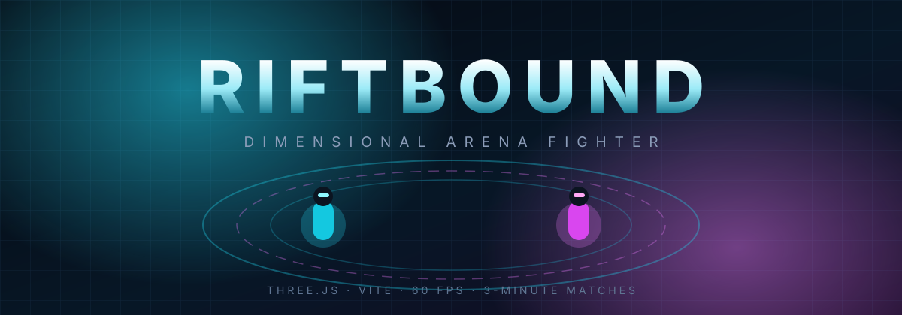

<p align="center">
  
</p>

<p align="center">
  
  
  
  
  
</p>

**RIFTBOUND** is a fast, neon-soaked 3D arena fighter that runs entirely in the browser. Two exo-suit fighters share one industrial arena, a shrinking three-minute clock, and the ability to **phase between the Material and Rift dimensions** mid-duel — trading armour for reach and repainting the whole arena in the process.

No installs, no servers, no accounts. Open the page, pick a mode, fight.

```bash
npm install
npm run dev      # → http://localhost:3000
```

---

## Table of contents

- [Features](#features)
- [Quick start](#quick-start)
- [Controls](#controls)
- [Game mechanics](#game-mechanics)
- [Game modes](#game-modes)
- [Tech stack](#tech-stack)
- [Architecture](#architecture)
- [Project structure](#project-structure)
- [Performance](#performance)
- [Design notes](#design-notes)
- [Roadmap](#roadmap)
- [License](#license)

---

## Features

- 🥊 **Two full fighters** — solo against an AI duelist, or two players on one keyboard.
- 🌌 **Dimension shifting** — flip between Material and Rift to change colour, fog, lighting and blade behaviour, at the cost of energy.
- ⚔️ **Melee combat with commitment** — swings have a wind-up, a damage window, and a cooldown, so timing beats button mashing.
- 🛡️ **Hold-to-defend** — a shield that cuts incoming damage by 75% but drains energy and slows you down.
- 🔋 **One shared resource** — sprinting, defending and shifting all pull from the same energy bar.
- 📊 **Live HUD** — health, energy, score and match clock update every frame.
- ⚙️ **Graphics presets** — Performance / Balanced / Maximum, adjustable in-game from the gear button.
- ✨ **Animated 3D presentation** — orbiting core rings, a spinning crystal, bobbing energy orbs, pulsing chest cores, blade arcs, shield shimmer, dimension-burst rings and particle death bursts.
- 📱 **Touch controls** — on-screen D-pad and action buttons on phones and tablets.
- 🧩 **Zero runtime dependencies beyond three.js** — no engine, no framework, no build-time magic.

---

## Quick start

**Requirements:** Node.js 18+ and npm.

```bash
# 1. install dependencies
npm install

# 2. start the dev server
npm run dev

# 3. open the URL Vite prints (http://localhost:3000)
```

**Production build**

```bash
npm run build     # → dist/
npm run preview   # serve the built bundle locally
```

The build output is a single static `index.html` plus one hashed JS bundle — it can be hosted on any static host (GitHub Pages, Netlify, Vercel, S3, Cloudflare Pages…).

---

## Controls

### Player 1

| Action | Input |
| --- | --- |
| Move | <kbd>W</kbd> <kbd>A</kbd> <kbd>S</kbd> <kbd>D</kbd> |
| Jump | <kbd>Space</kbd> |
| Sprint | <kbd>Shift</kbd> |
| Attack | Left mouse button |
| Defend (hold) | Right mouse button |
| Dimension shift | <kbd>F</kbd> |
| Pause | <kbd>Esc</kbd> |

### Player 2 (local mode)

| Action | Input |
| --- | --- |
| Move | <kbd>↑</kbd> <kbd>←</kbd> <kbd>↓</kbd> <kbd>→</kbd> |
| Jump | <kbd>Enter</kbd> |
| Sprint | <kbd>R</kbd> |
| Attack | <kbd>Numpad 0</kbd> |
| Defend (hold) | <kbd>Numpad 1</kbd> |
| Dimension shift | <kbd>G</kbd> |

### Touch

A virtual D-pad appears bottom-left and **ATTACK / DEFEND / SHIFT** buttons bottom-right on devices without a mouse.

> The camera automatically frames both fighters, so there is no mouse-look to fight with — the mouse is dedicated to attacking and defending.

---

## Game mechanics

| Stat / rule | Value |
| --- | --- |
| Max health | 100 |
| Max energy | 100 |
| Match length | 180 s (3:00) |
| Attack damage | 8 per hit |
| Attack cooldown | 0.8 s |
| Attack range | 4.2 units |
| Damage while defending | 25% of normal (75% reduction) |
| Defender movement speed | 40% of normal |
| Dimension shift cost | 40 energy |
| Dimension shift cooldown | 2.5 s |
| Energy regeneration | ~11 / second (paused while defending) |
| Sprint | 1.75× speed, drains energy |
| Respawn delay | 2.5 s after death |
| Scoring | 1 point per takedown |
| Arena bounds | ±22 units |
| Win condition | Highest score when the clock hits zero (health breaks ties) |

**Dimension shifting** is the signature mechanic: while in the **Rift**, the fighter turns magenta, the arena's fog thickens and the palette inverts to pink/cyan. Because shifting costs 40 energy, you cannot phase and sprint and shield at the same time — every fight becomes an energy-budget problem.

**Invincibility frames** of 0.45 s after a hit prevent stun-locking, and a swing only lands once, so trading blows is about spacing rather than spam.

---

## Game modes

### Play vs AI
Fight the AI duelist on the right side of the arena. The AI:
- closes distance with world-axis movement and circles at close range,
- commits to swings probabilistically (so it can be out-poked),
- defends when health is low,
- backs off for ~0.9 s after landing a hit,
- occasionally jumps, sprints and shifts dimensions.

### 2 Player Local
Both fighters on one machine: WASD + mouse for Player 1, arrows + numpad for Player 2. Health, energy and score are tracked for both sides of the HUD, and the camera widens automatically as the fighters separate.

---

## Tech stack

| Layer | Choice |
| --- | --- |
| Rendering | [three.js](https://threejs.org/) `^0.165.0` — WebGL, PCF soft shadows, ACES filmic tone mapping |
| Bundler / dev server | [Vite](https://vite.dev/) 5 |
| Styling | Hand-written CSS (no framework) |
| Language | ES modules + JSDoc-style comments |
| Assets | None — every model is procedural geometry, no textures |

Total: **one runtime dependency**.

---

## Architecture

```
             ┌──────────────────────────┐
             │        index.html         │  UI shell: menu, HUD, modals, touch
             └────────────┬─────────────┘
                          │ DOM events
             ┌────────────▼─────────────┐
             │        GameScene          │  match state, input mapping,
             │  loop · HUD · AI · camera │  hit resolution, quality presets
             └───────┬───────────┬──────┘
                     │           │
        ┌────────────▼──┐   ┌────▼──────────┐
        │    Arena      │   │    Player     │
        │ scene, lights │   │ mesh, physics │
        │ fog, dimension│   │ combat, FX    │
        └───────────────┘   └───────────────┘
```

- **`GameScene`** owns the single `requestAnimationFrame` loop. Each frame it advances the arena animation, updates players, resolves hits, syncs the dimension palette, repaints the HUD and smooths the camera toward a midpoint that keeps both fighters in frame.
- **`Arena`** builds the procedural scene (grid floor, walls with neon trim, eight pillars, a floating core with three orbiting rings, eight bobbing orbs with point lights, rift dome) and exposes `setDimension()` / `animate(delta)`.
- **`Player`** is self-contained: it builds its own mesh hierarchy, integrates gravity and world-axis movement, runs the attack/defend/shift state machine, spawns its own particles and clamps itself to the arena.

Input is polled rather than event-driven during the loop: `keydown`/`keyup` and `mousedown`/`mouseup` write into two plain input-state objects, which are handed to `Player.update(delta, inputs)`. This keeps the update path deterministic and makes adding a network layer straightforward.

---

## Project structure

```
riftbound/
├── index.html              # UI shell, styles, DOM wiring
├── src/
│   ├── scenes/
│   │   ├── Arena.js        # procedural arena + lighting + dimension palette
│   │   └── GameScene.js    # loop, input, HUD, AI, combat, camera
│   └── components/
│       └── Player.js       # mesh, movement, combat, abilities, FX
├── assets/
│   └── banner.svg          # README artwork
├── vite.config.ts
├── tsconfig.json
├── package.json
└── README.md
```

> `src/**/*.ts` contains earlier TypeScript drafts of the same classes. They are kept for reference but are **not** part of the build — the shipping game is the JavaScript implementation listed above.

---

## Performance

Measured in Chrome on the Balanced preset during a live match (two fighters, full arena):

| Metric | Value |
| --- | --- |
| Frame rate | **60 fps** sustained |
| Draw calls | 43 |
| Triangles | 11,510 |
| Geometries / textures | 59 / 1 (no image assets) |
| Production bundle | 516.74 kB → **132.29 kB gzipped** |
| Build time | ~2–15 s |

Graphics presets trim the cost further:

| Preset | Pixel ratio | Shadows | Fog density |
| --- | --- | --- | --- |
| Performance | 0.75 | off | 0.030 |
| Balanced | 1.0 | PCF soft | 0.021 |
| Maximum | min(DPR, 2) | PCF soft | 0.016 |

---

## Design notes

- **Delta-time everywhere.** Every system integrates with a per-frame delta, clamped to 100 ms so a backgrounded tab cannot teleport fighters through walls.
- **No texture assets.** All "neon" comes from emissive materials and tone mapping, which keeps the bundle tiny and the load instant.
- **Framing over free-look.** Because two players share one screen, the camera seeks the midpoint of both fighters and pulls back with their separation instead of attaching to one of them.
- **One resource, three sinks.** Sprint, defence and dimension shift competing for the same energy bar is what makes the duel read as a decision tree rather than a DPS race.

---

## Roadmap

- [ ] AI difficulty tiers (Rookie / Duelist / Riftborn) with reaction-time and aggression tuning
- [ ] Online 1v1 via Colyseus (the TypeScript draft in `src/multiplayer/` sketches the room)
- [ ] Additional arenas and hazards
- [ ] Sound design and music
- [ ] Gamepad support
- [ ] Local leaderboard / persistent stats

---

## License

Released under the [MIT License](LICENSE).

<p align="center"><sub>Built with three.js and a lot of emissive materials.</sub></p>
